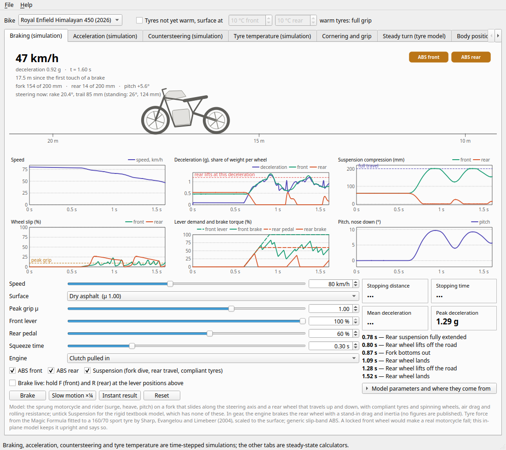
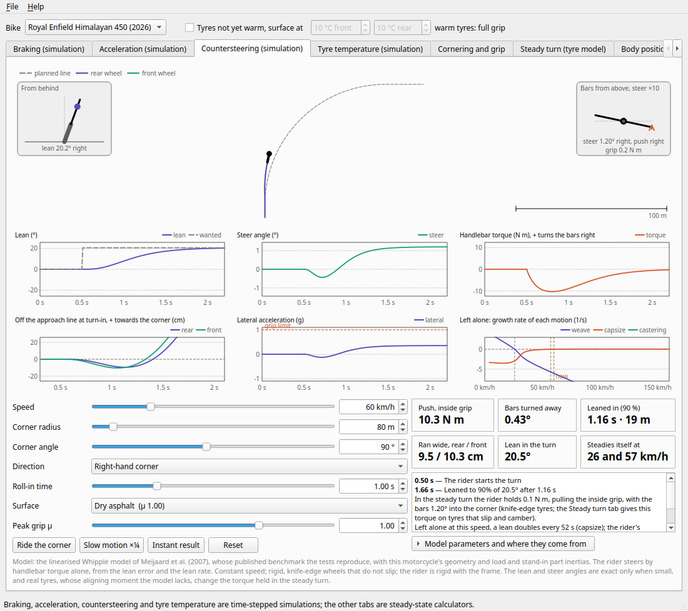
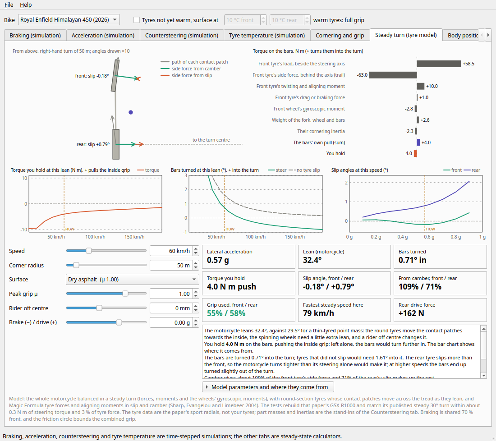

# kammcircle

kammcircle is a desktop motorcycle simulator built on Kamm's circle, the idea that braking and cornering draw on one shared grip budget. Its first time-stepped simulation is braking: you set the speed, the surface and the levers, or brake live from the keyboard, and watch the fork dive, the load move onto the front wheel, the tyres slip, the ABS cycle, a wheel lock or the rear rise into a stoppie. Version 0.10 solves a steady turn on tyres that slip and camber: the lean, each tyre's slip angle, how much of its grip it uses and the torque the rider holds on the handlebars, checked against a published steady turn of a GSX-R1000. Version 0.9 runs braking, acceleration, countersteering and cornering on tyres that are not yet warm, and calibrates the Himalayan 450's acceleration on a measured rear-wheel dyno run, so that it lands between two road-tested 0–100 km/h times. Version 0.8 added tyre temperature: how long tyres take to warm from a cold start in any weather, with cold roads, and what that does to their grip. Version 0.7 brought engine braking to the braking runs, with the engine's drag and inertia. Version 0.6 added a third simulation, a corner ridden in time by countersteering on the benchmark lean-and-steer model of Meijaard et al. (2007), with the speeds at which the motorcycle steadies itself. Version 0.5 added acceleration, with the manufacturers' gearing, launch and gear changes, wheelspin, wheelies and air drag. Version 0.4 added a tyre catalogue that feeds the simulation and records what is on sale in Morocco, a best-fit ranking of tyre pairs for your riding, and the load of a pillion and luggage. Calculators for steady cornering, body position, footpeg clearance and steering geometry complete it. It ships with sourced data for the Royal Enfield Himalayan 450 (2026) and Scram 411.



## What it does

| Tab | What you can explore |
|---|---|
| Braking (simulation) | A real-time run, in slow motion if you like, of a stop from any speed on any surface: front and rear brake levers (set in advance or held live on F and R), ABS on or off at each wheel, the clutch pulled in or a gear for engine braking, and the outcome, from a clean stop to a locked front wheel or a stoppie that goes over the bars. Live charts show speed, deceleration, the load on each wheel, suspension travel, pitch, wheel slip, and how much of each lever's demand reaches the brake; the view also shows how far the rake and trail shrink as the nose dives. Every model parameter is listed with where it comes from. |
| Acceleration (simulation) | A launch or a roll-on, in real time or at once, through the published gearing: launch speed, shift speed, throttle and optional throttle control (a skilled rider or traction control), on any surface, to a target speed or to the top speed. Live charts show speed, acceleration and the load on each wheel, engine speed and gear, rear-wheel slip, squat and pitch; results give the 0–50 and 0–100 km/h times. |
| Countersteering (simulation) | A corner ridden in real time, or at once, with handlebar torque alone: speed, radius, angle, direction and how quickly to lean in. The first push turns the bars away from the corner and both wheels run wide before the motorcycle turns in; the tab shows by how much, the peak push on the inside grip, the time and distance to lean in, and the torque held in the turn. A top view draws both wheels' tracks against the planned line, with insets of the lean from behind and the handlebars from above. A chart shows how fast each motion grows or dies away if the rider lets go (weave, capsize, castering), and the band of speed in which the motorcycle steadies itself. |
| Tyre temperature (simulation) | A ride from a cold start, a minute a second or at once: air and road temperatures, tyres parked outside or warmed, speed and riding style. Charts show each tyre's surface, tread and carcass temperatures and its grip as a share of a warm tyre's; results give when each tyre reaches its working window, its grip after five minutes and where it settles. The window itself is editable, as no maker publishes one. |
| Cornering and grip | Speed, corner radius, surface grip and braking give the lean the corner needs, the grip-limited lean, how much of the friction circle is in use, and the fastest speed the corner allows. An optional correction accounts for tyre width, which makes a real bike lean further than the ideal formula says. |
| Steady turn (tyre model) | The whole motorcycle balanced in a steady turn on Magic Formula tyres that slip and camber: the lean, the steer angle, each tyre's slip angle and the share of its side force that comes from camber, the grip in use, and the torque you hold on the bars, with a chart of where that torque comes from. Braking or driving in the turn and hanging off are inputs; charts show how the torque and steer change with speed at the same lean, and the slip angles as the cornering grows. |
| Body position | For the lean a corner demands, moving the rider inside or outside the bike's plane changes how far the bike itself leans: less when hanging off on tarmac, more when standing on the outside peg on gravel. |
| Steering geometry | Lowering the rear, the front or both changes rake, trail and ground clearance. The side view exaggerates the angle changes five times so that they are visible, while the numbers stay real. A different front tyre size changes the trail too. |
| Tyres | Fit a front and a rear tyre from the catalogue: the simulation takes their size (wheel radius, crown radius) and the tab checks their load and speed ratings against your load and the original fitment. The catalogue lists every tyre recorded in the bike's sizes, with its road/off-road split where the maker publishes one, the maker's dimensions, and the prices and stock seen at Moroccan retailers with the date checked. A best-fit ranking scores front-and-rear pairs against your share of unpaved riding and says why it left any tyre out. |
| Rider and bike | Your own values (rider mass, centre-of-gravity heights, sag, tyre crown radius, footpeg geometry, and a pillion's and luggage's mass and position) are saved for your user account only, and the footpeg clearance lean follows from them. The selected bike's catalogue figures are listed with their status and links to their sources. |

## Install and run

kammcircle needs Python 3.10 or later and uses PySide6 (Qt 6).

```bash
git clone https://github.com/achrafsoltani/kammcircle.git
cd kammcircle
python3 -m venv .venv
.venv/bin/pip install -e .
.venv/bin/kammcircle
```

`python -m kammcircle` starts the app as well.

## The physics

Every formula is a small pure function in `kammcircle.physics`, written with degrees at its interface, millimetres for chassis and tyre geometry, and metres, metres per second and kilograms for dynamics. [`docs/physics.md`](docs/physics.md) gives each formula with its derivation and worked numbers. The test suite pins the reference values below, and it checks the two derived formulas (the tyre-width lean and the rider-offset lean) against explicit geometric constructions rather than against their own output.

| Quantity | Value |
|---|---|
| Lean for 1 g of lateral acceleration | 45.0° |
| 60 km/h on a 50 m radius | 0.57 g, 29.5° |
| Grip-limited lean for μ = 1.0 / 0.6 / 0.3 | 45.0° / 31.0° / 16.7° |
| Himalayan 450 front tyre radius (90/90-21) | 347.7 mm |
| Himalayan 450 fork offset, back-solved from 26° and 124 mm | ≈ 41 mm |
| Himalayan 450 rear lowered 30 mm | rake 27.1°, trail ≈ 132 mm |
| Himalayan 450 front lowered 30 mm | rake 24.9°, trail ≈ 116 mm |
| Himalayan 450 both ends lowered 30 mm | rake 26°, trail 124 mm, ground clearance 230 → 200 mm |

## The braking simulation

Every 0.5 ms the simulation moves the sprung motorcycle and rider, a fork that slides along the steering axis, a rear wheel that travels up and down, compliant tyres that can leave the road, and two spinning wheels, turning each wheel's slip into braking force with the Magic Formula tyre fit published by Sharp, Evangelou and Limebeer (2004). A rigid model, without suspension, remains a tick-box away. Their equations, the ABS model and every parameter, each with its source or labelled as a stand-in, are in sections 10 and 11 of [`docs/physics.md`](docs/physics.md). The tests check the rigid model against the textbook load transfer, the rear-lift threshold `g·(L − b)/h`, the limit `v²/(2·μ·g)` and a skilled rider's best lever split, and the suspended one for exact static equilibrium, energy conservation and agreement with the rigid model when its springs are made stiff.

## The countersteering simulation



The lean-and-steer model is the linearised Whipple model in the benchmark form of Meijaard, Papadopoulos, Ruina and Schwab (2007), and the tests reproduce that paper's published matrices, eigenvalues and critical speeds to ten or more decimal places. This motorcycle's rake, trail, wheelbase and tyres enter it directly; the inertias of its parts are stand-ins measured on another motorcycle by Sharp, Evangelou and Limebeer (2004), each labelled in the tab. The rider is a feedback controller that steers by torque from the lean error and the lean rate, with gains placed so that the lean settles in the time you choose. Section 16 of [`docs/physics.md`](docs/physics.md) gives the equations, the results for the Himalayan 450 and the model's limits.

## The steady-turn solver



The steady-turn tab balances every force and moment on the motorcycle in a turn, with round-section tyres whose contact patches move across the tread as they lean and the Magic Formula tyre fits for slip and camber published by Sharp, Evangelou and Limebeer (2004). The tests check it three ways. With thin tyres that do not slip it reduces to the benchmark's steady turn. With point masses it reduces to the tyre-width and body-position formulas. Rebuilt as the paper's GSX-R1000, it reproduces the paper's steady 30° turn within 0.26 N m of steering torque and 2.5 % of side force, and its steer angle changes sign at 20.7 m/s, where the paper says "just over 20 m/s". The tyre data are those of sport radials, not of these motorcycles' tyres, so the tab shows the mechanisms: camber doing most of the cornering, the rear tyre slipping more than the front, and braking in a turn standing the motorcycle up. Section 18 of [`docs/physics.md`](docs/physics.md) gives the model, the checks and the results.

## Data and provenance

The bike, tyre and surface figures live in `src/kammcircle/data/`. Tyre prices are what two Moroccan retailers showed on the date recorded with them; check before buying. Each one carries a status: `verified` when it was read from a cited source, `derived` when it is computed from verified figures with the formula recorded, and `unpublished` when the manufacturer gives no figure, in which case the value stays empty rather than being guessed. Royal Enfield, for instance, publishes no lean angle for either bike, so the app asks you to measure the footpeg geometry instead. Source ids resolve in [`docs/sources.md`](docs/sources.md), and the tests fail if a status is unknown, a source id does not resolve or a derived value no longer recomputes.

## Limitations

The braking simulation's springs are linear, without preload or the rising rate of a real fork, so its dive is probably exaggerated; the rear wheel moves straight up and down rather than on the swingarm's arc; engine braking rests on stand-in figures for the engine's drag and inertia, which no maker publishes; and a locked front wheel does not make the motorcycle fall as it would on the road (the app says so). The countersteering simulation is linear, so its lean and steer are exact only when small (the tab warns beyond 25° of lean); its wheels are knife edges that neither slip nor have width, its frame is rigid, and its rider steers with the hands alone, which is slow below about 40 km/h. The steady-turn solver uses a sport radial's published data as a stand-in for these motorcycles' tyres, and bounds combined braking and cornering by the friction circle because the published combined-slip functions were fitted without camber. The other tabs are steady-state calculators: constant speed on a constant radius over a flat road, with one friction coefficient per surface. Next come anti-squat and the tyre model in the time-stepped corner; the list is at the end of [`docs/physics.md`](docs/physics.md).

## Development

```bash
.venv/bin/pip install -e '.[dev]'
.venv/bin/pytest                                           # physics, data provenance and offscreen UI tests
.venv/bin/python tools/gen_sources_md.py                   # regenerate docs/sources.md after editing sources.json
QT_QPA_PLATFORM=offscreen .venv/bin/python tools/screenshots.py   # regenerate docs/screenshots/
```

The reference illustrations in [`docs/illustrations/`](docs/illustrations.md) are the design masters for the app's views.

## Licence

kammcircle is released under the MIT Licence; see [`LICENSE`](LICENSE).
